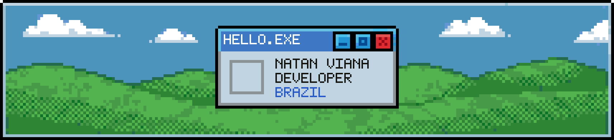
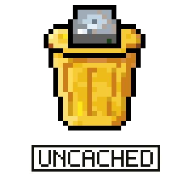
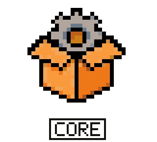
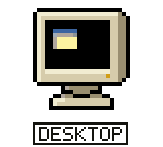
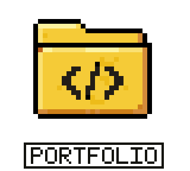

  

  Building <a href="https://uncached.app"><b>Uncached</b></a>, an open-source disk cleaner for developers.

  
  
  
  
  

  <code>Rust</code> · <code>TypeScript</code> · <code>React</code> · <code>Tauri</code> · <code>Astro</code> · <code>Cloudflare</code> · <code>Godot</code>

  

