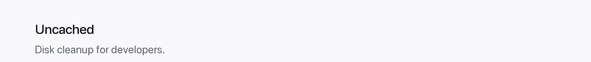

  <a href="https://natanviana.dev">
    <picture>
      <source media="(max-width: 600px)" srcset="assets/minimal/header-mobile.png" />
      
    </picture>
  </a>

  <a href="https://uncached.app">
    <picture>
      <source media="(max-width: 600px)" srcset="assets/minimal/project-mobile.png" />
      
    </picture>
  </a> 
  <a href="https://uncached.app"><picture><source media="(max-width: 600px)" srcset="assets/minimal/website-mobile.png" /></picture></a><a href="https://github.com/uncached-app"><picture><source media="(max-width: 600px)" srcset="assets/minimal/source-mobile.png" /></picture></a>

  <picture>
    <source media="(max-width: 600px)" srcset="assets/minimal/stack-mobile.png" />
    
  </picture>

About &amp; links

I build web and mobile products, from the first interface to the production deploy. Based in Brazil, working with people everywhere.

[Check my portfolio](https://natanviana.dev)

[**Uncached**](https://uncached.app) — an open-source disk cleaner for developers.

[Project](https://github.com/uncached-app) · [Core](https://github.com/uncached-app/uncached-core) · [Desktop](https://github.com/uncached-app/uncached-desktop) · [Website](https://uncached.app)

Rust · TypeScript · JavaScript · Python · React · Node.js · Tauri · Astro · Cloudflare · Godot · and more

